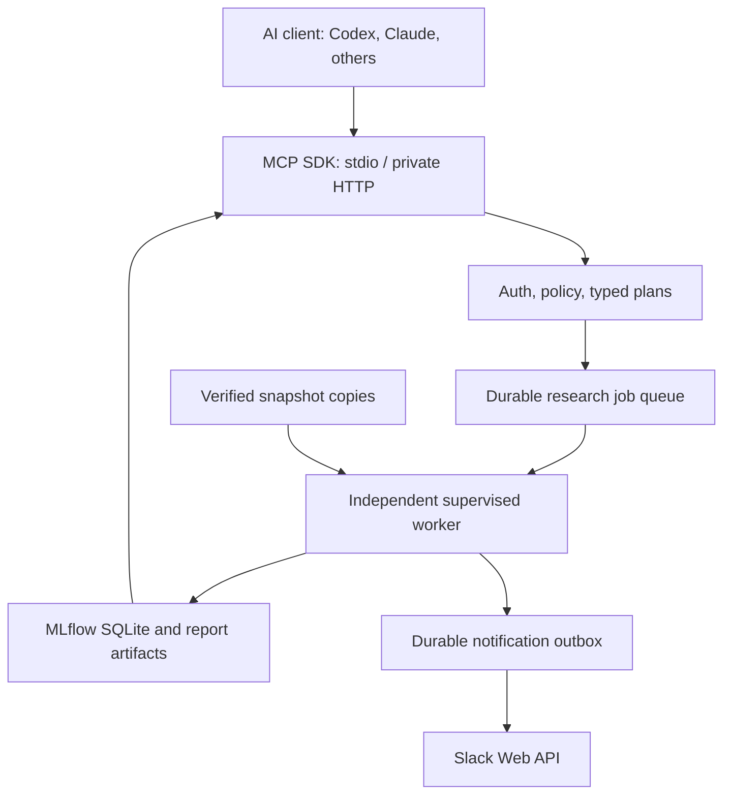

# FLOOR AI Lab — implementation checkpoint

Related: [OKR #261](https://github.com/jcval94/floor/issues/261), [FLOOR 2.0 #253](https://github.com/jcval94/floor/issues/253).

**Local research prototype; not deployed, not integrated into official operation, no Slack delivery yet.** It includes an actual MCP server, separately supervised durable SQLite queue, registered Python computations, MLflow SQLite tracking and HTML/JSON artifacts. A configured Slack Web API adapter/outbox is included; mocks are not counted as live deliveries. No cloud resources/billing/credentials were created.

Frozen-model extension (contract 1.1): [design](ADR-002-frozen-models.md) and [measured comparison](frozen-models.md). The original 1.0 evidence remains a separate checkpoint.

Read [audit](audit.md), [ADR](ADR-001.md), [contracts](tool_contracts.md), [connection/runbook](connect.md), [Slack](slack.md), [security](security.md), [E2E evidence](e2e_results.md), [KR/roadmap](okr.md), [snapshot catalog](catalog.md).



MCP is control plane. `worker.py` is execution plane; it must stay running independently of ChatGPT/Claude/Codex. The queue survives client shutdown and worker restart on the same persistent volume. This does **not** make a Work workspace a deployed service. Host power loss stops compute; restart marks interrupted jobs explicitly FAILED, never silently SUCCEEDED or retried.

## Scope of this checkpoint

- Three research recipes: same-fold W1 model comparison (Dummy, Ridge, ExtraTrees), feature audit (missingness/constants/redundancy, training-derived outlier fences, distribution distance and OOS permutation importance by fold), and controlled feature ablation. Fixed hyperparameters, baseline always included, train-fitted imputation/scaling.
- Purged expanding whole-date evaluation reuses `models.temporal_cv`. No random train/test split, test-set hyperparameter selection, automatic production promotion or trading.
- These research estimators are **not the three existing production champions**. The new `frozen_model_comparison` recipe separately reuses exact FLOOR serialized floor/ceiling heads and frozen risk geometry. Its shared post-artifact window is explicitly **not verified OOS** because exact training/selection cutoffs are absent. Timing is not yet compared. XGBoost/LightGBM and VIX requests are not silently substituted.
- Dataset imports are operator-only. MCP accepts registered dataset IDs, never paths/URLs/SQL/shell/code. `available_at` is checked per feature and observation. Reconstructed provider history is labeled retrospective, never vintage PIT evidence.
- IDs, deduplication, actor quotas, resource/time limits, cancel requests, structured failure, outbox delivery states and checksummed artifacts are implemented. Single worker/FIFO; priority scheduling, checkpoints for long training and paid compute are deferred.
- MLflow owns tracking metadata. The small control DB owns queue/permissions/outbox; it is not a replacement tracking platform. No persistent MLflow server and no online feature-store service.

## Reproduce locally

Use Python 3.11+ on Linux (worker uses POSIX resource controls and flock). In a dedicated venv:

```bash
python -m venv .venv
.venv/bin/pip install -e .
.venv/bin/pip install -r docs/ai-lab/requirements.txt
.venv/bin/pip install pytest
PYTHONPATH=src .venv/bin/python -m pytest tests/ai_lab
```

Operational workflows/dependencies are unchanged. Research extras must be installed explicitly; optional tests skip when extras are absent. A fully frozen transitive lock/container digest is a prerequisite for portable deployment, not supplied by this direct-dependency list. Each run records observed package versions and source hashes.

Import an already downloaded immutable snapshot, using its independently checked sidecar/metadata hash. Extract **only** `data/market/market_data.sqlite` to a research directory; do not run restore scripts against official state. The importer verifies archive bytes and DB membership, checks NYSE sessions and excludes candles fetched before session close.

```bash
PYTHONPATH=src .venv/bin/python -m ai_lab.import_snapshot \
  --root /absolute/persistent/floor-lab \
  --db /absolute/research-copy/market_data.sqlite \
  --archive /absolute/downloaded/immutable-runtime-archive \
  --archive-hash HASH_FROM_VERIFIED_SIDECAR \
  --source-run-id SOURCE_RUN_ID
```

Returned `dataset_id` identifies rows+manifest immutably. Import copies, not raw production tables, feed the recipes. The CLI makes no network download or production mutation. Materializations store availability **assumptions** explicitly and reject incomplete session histories. NYSE calendar version is recorded.

Run the worker under a supervisor, then connect MCP as described in [connect.md](connect.md). To exercise the actual Python MCP wire and disconnect scenario:

```bash
PYTHONPATH=src .venv/bin/python -m ai_lab.smoke \
  --root /absolute/persistent/floor-lab \
  --dataset RETURNED_DATASET_ID \
  --output /absolute/research-copy/smoke.json
```

This harness launches and later stops its independent worker for a bounded test. Permanent operation requires the separately installed supervisor. Reports live under `<root>/runs/<run_id>/`, with `report.html`, `result.json`, `predictions.json`, `provenance.json`, `artifacts.json`. Never publish these directories without access review.

## Cost and retention

Only local compute is enabled; cloud budget is USD 0/job, with no paid backend fallback. Hard caps: 10 jobs/day per volume, 5/day per actor, 100/month, 10 queued/running, one active worker, 120s wall max, 4096MB address-space max, 32MB individual child output file, 512MB pre-submit total volume guard. Defaults: 60s, 3072MB. Local electricity, host purchase, Internet and assistant subscription are outside the cloud budget. This is not an observed provider invoice or promise of free remote hosting.

`floor_get_retention_plan` is administrator-only dry-run; it proposes regenerable HTML older than 30d and protects manifests, metrics, OOS predictions, referenced datasets and active runs. It does not delete anything. MLflow copies also count toward the volume guard. Once full, jobs block until an operator reviews export/backup/GC; no loss of reproducibility is hidden behind cleanup.

Proposed larger-object policy: caches 72h; detailed successful logs 14d; derived plots 30d; unused nonpromoted heavy objects 90d; exact dataset/provenance/minimum metrics while depended upon. First deletion of existing evidence requires dry-run, impact, restore proof and explicit approval. This checkpoint has not applied TTL deletion to official or existing data.

## Twenty ready-to-use requests

For an assistant already connected to the tools. Dataset must first be registered; assistant must inspect capabilities and review returned exact plans. The honest unavailable response is part of the contract.

| Request in Spanish | Current behavior |
|---|---|
| 1. ¿Qué capacidades tiene FLOOR AI Lab? | Implemented discovery |
| 2. ¿Qué experimentos míos fallaron y por qué? | Implemented list/status/error |
| 3. Muéstrame los datasets registrados y sus hashes. | Implemented catalog |
| 4. ¿Cuáles son los modelos de investigación disponibles? | Implemented model list |
| 5. Lista las primeras veinte features y sus definiciones. | Existing registry, paginated |
| 6. Compara Dummy, Ridge y ExtraTrees para W1 en este dataset. | Registered model comparison |
| 7. Valida la disponibilidad temporal antes de ejecutar. | Registered plan validation |
| 8. ¿Cuánto costará este experimento y cuáles son sus límites? | Local budget/resource estimate |
| 9. Ejecuta este plan aprobado con clave experimento-001. | Durable submit, runner role |
| 10. Revisa cuáles features aportan valor en W1. | Feature-audit plan, explicit scope |
| 11. Elimina experimentalmente ret_lag_1 y compara. | Ablation plan, serving unchanged |
| 12. ¿Qué features son constantes o altamente correlacionadas? | Feature-audit results |
| 13. ¿La importancia cambia entre ventanas temporales? | Per-fold permutation results |
| 14. Muéstrame las métricas y el reporte del run indicado. | Measured results/artifact list |
| 15. ¿Qué snapshot y código produjeron este resultado? | Run provenance |
| 16. Compara estas dos ejecuciones del mismo experimento. | Fail-closed comparability check |
| 17. Cancela mi experimento y confirma cuando termine. | Cancellation request, then terminal status |
| 18. ¿Se entregó realmente el informe a Slack? | Outbox state and real ts if delivered |
| 19. Reenvía el reporte cuya entrega falló sin reentrenar. | Known-failed notification retry; UNKNOWN requires review |
| 20. Prueba si agregar VIX mejora el forecast. | Proposal AWAITING_APPROVAL, no generated code execution |
| 21. Compara mean reversion y breakout con costos de FLOOR. | Not available yet; reviewed existing-backtest adapter required |
| 22. Compara los champions actuales y sus predecesores OOS. | Frozen-head comparison available; exact training boundary absent, so reports post-artifact reconstructed holdout and OOS unverified |
| 23. Dame las mejores oportunidades de esta semana. | Not available; does not fabricate #258 results |
