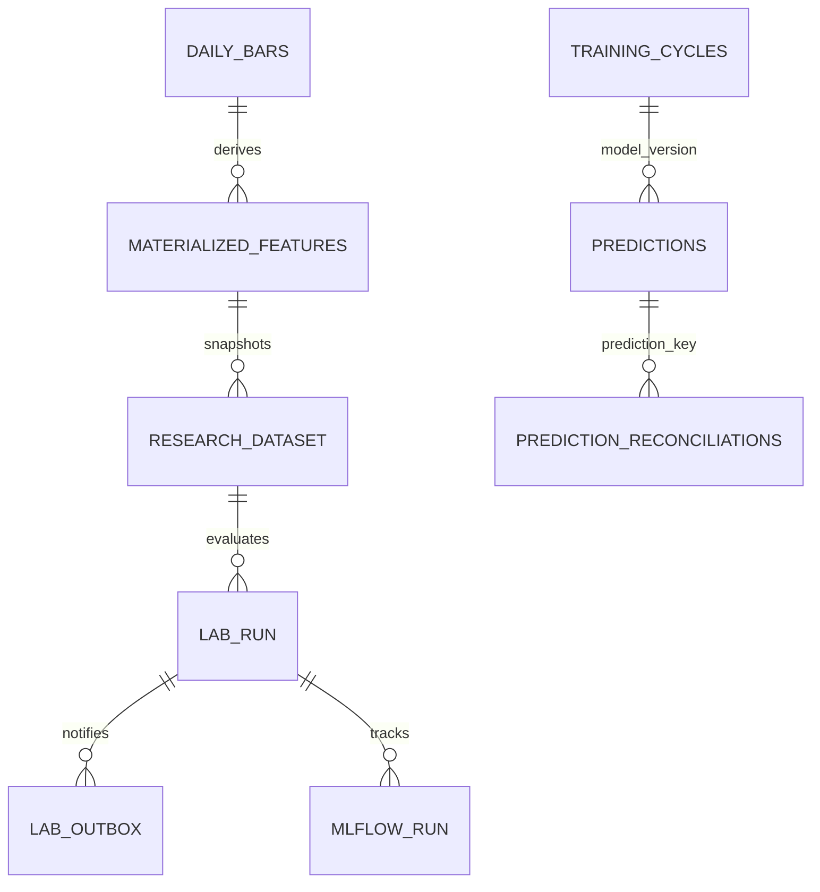

# FLOOR audit — isolated research, 2026-11-13

Base main `ad985366b0cf65084523d876f66ca5dedcb68941`. Issues read before edits: #261, #253, #255, #257, #258, #259. Open PRs #252/#251/#240/#235/#185/#184 remain independent; this work neither assumes nor merges their changes.

## Observed authority and snapshot

Git holds code, configuration and lightweight JSON models. Runtime Release is authoritative operational state; Actions artifacts have finite retention. SQLite is an operational projection. Never reinterpret research/replay or Pages green as official EOD completion.

Observed Release `runtime-state-v1` has an old base archive (generation 24, September) alongside newer immutable run assets. Chose immutable `floor-runtime-state.tar.gz.run-43303225713-a1` (generation 158, generated 2026-11-12T20:45:22Z, source commit matches audited main). Verified archive SHA-256 **ec1c4dcfe2dd51180d60ec2fc060dd91a1efeda2aef90498f2907b97e724d370**, sidecar and metadata; no Release modified. These checks prove content consistency, not signed publisher authenticity or historical PIT availability.

Both extracted SQLite copies passed `integrity_check`. Observed market DB: 9,981,952 bytes, 51,153 bars, 51 symbols, through 2026-11-12. Operational DB: 855,199,744 bytes. Tables/rows: predictions 120,000; signals 153,456; orders 0; training_reviews 58; model_training_cycles 30; model_competition_results 0; prediction_reconciliations 335,934. All eight physical domain tables across these two stores are cataloged in [catalog.md](catalog.md), including DDL, columns, PKs, indexes, nullable/defaults. This is one observed snapshot, not a complete inventory of every remote Release asset. MLflow/lab tables are additional isolated research state.

Latest operational prediction `as_of`: 2026-11-12T09:30:00-05:00; latest reconciliation timestamp 2026-10-14T21:00:13Z. A recent archive timestamp does not demonstrate reconciled EOD or current league. No live or paper broker execution was enabled.

## Capability matrix

Effort: S=1–2 engineering days; M=3–5; L=1–2 weeks. Estimates, not promises. Paths are existing main implementations unless stated prototype.

| Capability | Existing implementation | Limitation / risk | Proposed reuse or repair | Priority | Effort | Dependencies |
|---|---|---|---|---|---|---|
| Market store | `storage/market_db.py`, daily_bars PK symbol/time | Mutable fetched history; daily timestamps are session open, OHLC known later | Verified isolated archive import; close-time/fetch gate; hash and temporal evidence | P0 | S | calendar, snapshot |
| Operational store | `floor/persistence_db.py`, 7 domain tables | Large payloads; no declared FKs observed; IDs not proof of business identity | Read-only schema profiler, logical joins, no physical FK migration yet | P1 | M | snapshot |
| Authority/restore | `scripts/runtime_state.sh`, Release sidecars, CAS writer | Multiple named state releases; rolling base can be older than immutable assets | Explicit immutable asset selection, checksums; keep research separate | P0 | M | #255 |
| Forecast serving | `forecasting/parity_models.py`, `models/classic_horizon_predictor.py` | Family names historically misleading; require exact params; frozen metrics not directly comparable | Adapter must use serving contract and known training cutoff; not shipped as a fake comparison | P1 | M | PIT feature evidence |
| Training | `models/run_training.py`, classic/timing/value trainers | Existing production gates must stay intact | Register isolated adapters, never call promotion entry points | P1 | M | dataset contract |
| Validation | `models/temporal_cv.py`, `replay/walk_forward_oos.py` | Purging requires valid target_end metadata; fallback paths unsuitable for unknown data | Reuse purged expanding whole-date folds; strict metadata before invoking | P0 | S | target/session contract |
| Metrics | `models/evaluate.py`, central/risk reports | Different targets/risk geometries; metrics from different datasets cannot be ranked together | Preregister shared MAE/RMSE first; keep coverage/timing/geometry adapters separate | P0 | M | same splits/data |
| Features | `features/feature_builder.py`, feature_registry, labels | leakage_safe registry flag is not materialization-time proof; AI sheets need vintages | Versioned feature manifest; availability per row/feature; experimental audit/ablation | P0 | M | source lineage |
| Strategy research | `backtest/`, `replay/`, `strategies/research_registry.py` | Must preserve sessions/costs/epochs; missing prices fail closed | Future registered adapter, not new backtest math | P1 | M | #253/#256 |
| Costs | `config/costs.yaml`, `backtest/cost_model.py`, domain cost profiles | Research/PAPER have distinct sell fees; zero broker default unsafe | Read authoritative strategy profile: 26+3 each side +3 sell =61 bps roundtrip | P0 | S | cost profile |
| League | `league/engine.py`, live_snapshot, state hashes | Known historical EOD gap; incomplete prospectivity | Official subsystem stays unchanged; read-only adapter pending state contract | P0 | L | #248/#255/#259 |
| Finder | `forecasting/rank_opportunities.py`, #258 | Ranking is not validated catalyst/PIT Opportunity Finder | Research adapter returns NOT_AVAILABLE until evidence exists | P1 | L | #258 |
| Reconciliation | `floor/persistence_db.py`, reconciliation utilities | More reconciliations than retained predictions; potential retention-induced orphan joins | Profile logical keys before imposing FKs; preserve history | P1 | M | #255 |
| CI/CD | 24 `.github/workflows/*.yml`; CI lint/mypy/tests/Pages audits | Workflow success is not official state; adding cron duplicates #253 | No existing workflow edits; optional research checks/runbooks only | P0 | S | integration approval |
| Notifications | `notifications/` Telegram/ntfy/Resend | No existing Slack outbox | Isolated Slack Web API adapter with delivery states/retry/manual ambiguous reconciliation | P0 | M | authorized app/channel/token |
| Tracking | Small JSON model registry, Actions evidence | No shared MLflow tracking in audited code | On-demand MLflow+SQLite, artifact volume, no permanent server | P0 | S | persistent local storage |
| MCP/control | None in audited main | No universal typed control plane or durable experiment queue | Official SDK transports, schema contracts, isolated transactional queue | P0 | M | approved hosting for remote |
| Novel experiments | Research scripts and PR review | Arbitrary LLM code cannot safely inherit secrets | Spec → isolated PR → review → sandbox → registered adapter | P2 | L | sandbox and reviewed code |

## Official vs experimental ownership

Official: EOD session commits, league/NAV, checkpoints, current champions, risk/cost configuration, PAPER/LIVE safeguards, authoritative Releases, Pages publication gates. This branch owns none of them.

Experimental: content-addressed imported copies; lab queue/outbox/MLflow DBs; fixed-model recipes; reports and OOS predictions; feature recommendations; proposals. No recommendation automatically modifies serving, features, strategies, thresholds or model registry.

## Data relationships (logical, not newly enforced FKs)

`MATERIALIZED_FEATURES` and `RESEARCH_DATASET` are logical objects/files, not proposed new production tables. The prototype is a versioned feature catalog/materialization system, not an online feature-store service. No evidence justifies Feast/managed feature storage yet. Version feature definitions through Git and exact materialization manifest; retain feature availability assumptions separately from code provenance.

## Safety and remaining audit scope

No destructive migrations or cleanup. `schema_version=1` only initializes the new research store; official migrations remain forward-only proposal with restore rollback pending #255. Full external-provider catalog, per-field business descriptions/ownership, orphan remediation, five production-consumer query benchmarks, two complete official-state restores and ten sessions of new integrity evidence are not established by this prototype. They remain explicit KR work; no completeness claim is made for those items.
